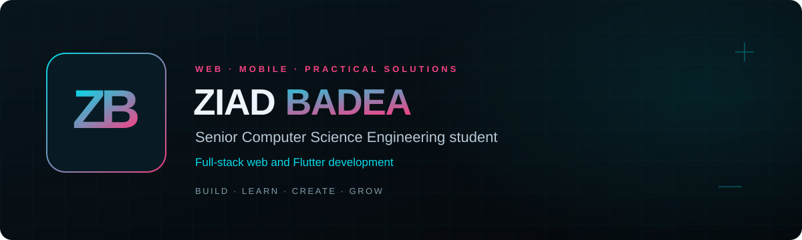

# Ziad Badea

[Visit my portfolio](https://zoz0011.github.io/ziad-badea-portfolio/) · [LinkedIn](https://www.linkedin.com/in/ziad-badea-6272a7301/)

**Senior Computer Science Engineering student · Full-stack web and Flutter development**

I build web and mobile projects around practical workflows: pharmacy operations, financial records, medical appointments, and personal health logging. My work includes React and Node.js applications, Arabic RTL interfaces, and Flutter prototypes.

## Featured projects

| Project | What it does | Main technologies | Source | Preview |
| --- | --- | --- | --- | --- |
| **PharmaCore** | Pharmacy inventory, barcode POS, purchasing, sales reports, and role-based workflows. | React, Node.js, Express, Prisma, SQLite, Firebase | [Repository](https://github.com/Zoz0011/pharmacy-system1) | [Live website](https://pharmacy-system-ac68e.web.app/) |
| **Safi Debt Ledger** | Arabic web and Android ledger for debts, payments, balances, reports, and offline synchronization. | JavaScript, HTML, CSS, Supabase, Capacitor | [Repository](https://github.com/Zoz0011/debt-ledger-unified) | [Live website](https://safi-ledger-eg.pauper-93phylumbunni.chatgpt.site/) |
| **Prescripto** | Appointment platform with patient, doctor, and administrator interfaces. | React, Tailwind CSS, Node.js, Express, MongoDB, Cloudinary | [Repository](https://github.com/Zoz0011/prescripto) | [Live website](https://prescripto-frontend-50eh.onrender.com/) |
| **DiaCare Mom** | Arabic Flutter prototype for glucose logs, manually recorded insulin information, and clinician care-plan references. | Flutter, Dart, encrypted on-device storage | [Repository](https://github.com/Zoz0011/diacare-mom) | [Browser preview](https://zoz0011.github.io/ziad-badea-portfolio/demos/diacare/) · Mobile prototype |

Hosted applications retain their own sign-in and access requirements. DiaCare Mom organizes records; it does not determine medication doses or treatment decisions.

## Technologies

- **Languages:** JavaScript, Dart, HTML, CSS, SQL.
- **Web and mobile:** React, Node.js, Express, Tailwind CSS, Flutter, Capacitor.
- **Data:** MongoDB, SQLite, Prisma, Firebase/Firestore, Supabase.
- **Practices and tools:** Git, REST APIs, JWT, responsive interfaces, Arabic RTL, Firebase Hosting, Render.

## Portfolio

[Portfolio source](https://github.com/Zoz0011/ziad-badea-portfolio) — English/Arabic project details and interactive browser previews.

## Connect

[LinkedIn — Ziad Badea](https://www.linkedin.com/in/ziad-badea-6272a7301/)

Build · Learn · Create · Grow

